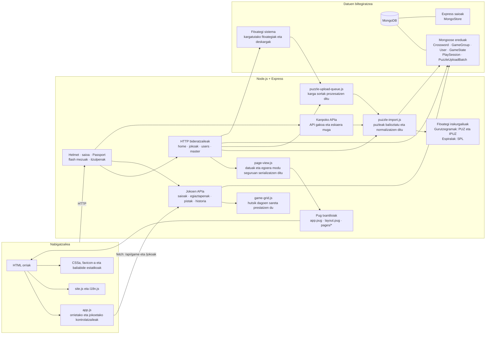

# Xederaren arkitektura

Aplikazioaren egungo egitura: Express zerbitzaria, Pug txantiloiak eta nabigatzaileko JavaScript natiboa.

## Orrien ibilbidea

- Hasierako orria (`/`) `home.pug` txantiloiarekin errendatzen da; txantiloi horrek `layout.pug` erabiltzen du oinarri.
- Gainerako orriak `page-view.js` eta `app.pug` bidez errendatzen dira. `app.pug`-ek `views/pages/` karpetako orri egokia eta goiburua eta orri-oina txertatzen ditu.
- `app.js`-ek orriaren HTMLko atributuen arabera abiarazten ditu kontrolatzaileak. `site.js`-ek nabigazio partekatua kudeatzen du; `i18n.js`-ek, berriz, itzulpenak.

## Jokoen eta puzleen ibilbidea

- `GET /jokoak/game/:id` eskaerak puzlea kargatzen du. PUZ eta IPUZ gurutzegramak `Crossword` egitura partekatuan normalizatzen dira; SPL jokoak `SpiralPuzzle` irakurgailuak kargatzen ditu. Zerbitzariak jolasteko behar diren datuak soilik bidaltzen ditu, erantzunak bezeroari erakutsi gabe.
- Joko-ekintzek `/api/game` APIra jotzen dute. Uneko jokoaren egoera Express saioan gordetzen da; erabiltzaile-kontu bati lotutako aurrerapena `GameState` eta `PlaySession` ereduetan gordetzen da.
- Puzle-kargak `jokoak` bideratzaileetatik igarotzen dira, eta `puzzle-upload-queue.js`-k eta `importPuzzle()` funtzioak prozesatzen dituzte. Emaitza `Crossword` dokumentu gisa gordetzen da; sorta eta haren egoera `PuzzleUploadBatch` ereduan erregistratzen dira.
- Ondo inportatutako jatorrizko fitxategiak `uploads/UUUU-HH-EE/` karpetan gordetzen dira, kargaren egunaren arabera (`Europe/Madrid`). Karpeta automatikoki sortzen da; jatorrizko izen segurua eta luzapena mantentzen dira, identifikatzailerik gehitu gabe. Egun berean izen bera badago, eduki bera duen fitxategia berrerabiltzen da; bestela, `_2`, `_3` eta hurrengo atzizki librera igotzen da, aurreko fitxategiak gainidatzi gabe. Balioztatu bitartean aldi baterako fitxategiak erabiltzen dira; joko baliogabeak edo errepikatuak eta huts egindako inportazioen fitxategiak ezabatu egiten dira. Sortek karpetarekiko bide erlatiboa gordetzen dute, prozesamenduak edo berrabiarazteak beste egun batean jarraituta ere fitxategia aurkitzeko.
- `/external` APIak puzleak zerrendatu, inportatu eta ezabatzeko aukera ematen du. API gako bidez babestuta dago eta eskaera kopuruaren muga du.

## Jokoen antolaketa

- `GameGroup` ereduan gordetzen dira taldearen izena, aukerako azalpena, `parentId`, `sortOrder` eta talde babestuen `systemKey`. Talde bakoitzak guraso bakarra dauka; azpitaldeek beste azpitalde batzuk izan ditzakete. `Crossword.groupIds` eremuak joko baten taldeak gordetzen ditu, jokoa bikoiztu gabe. Talde batek zuzenean esleitutako jokoak erakusten ditu, ez bere ondorengoen joko guztiak.
- `/jokoak` erroko orria da; `/jokoak/taldeak/:id` talde arrunten orria da. Identifikatzailearen bidezko estekek izena edo gurasoa aldatzean ere balio dute. Orri guztiek azalpena, berehalako azpitaldeen estekak eta oraingo joko-zerrenda partekatzen dituzte. Edukirik gabeko atalak ez dira HTMLan sortzen: ez azalpen hutsik, ez esteken edukiontzi hutsik, ez joko-zerrenda hutsik.
- `/jokoak/guztiak` orriak datu-baseko joko guztiak kontsultatzen ditu, baita talderik gabekoak ere. `Guztiak` erroaren azken esteka da beti eta ez du eskuzko joko-esleipenik. `Jokoak` eta `Guztiak` ezin dira ezabatu, izenez aldatu edo mugitu; azalpenak editagarriak dira.
- `/master/groups` pantailak egitura eta joko-esleipenak kudeatzen ditu. `master` baimena eskatzen du irakurketan eta aldaketa guztietan. Taldeak sortu, editatu, ordenatu eta beste guraso batera mugi daitezke. Zikloak eta ondorengo baten barrurako mugimenduak baztertzen dira. Taldeak ezabatzeko ez dute azpitalderik, zuzenean esleitutako jokorik edo zain dauden kargarik izan behar.
- Jokoak talde batera gehitu, talde batetik kendu edo bi talderen artean mugi daitezke, banaka edo multzoka. Mugimenduak gainerako taldeak gordetzen ditu eta joko bakoitzaren aldaketa atomikoa da. Jokoaren identifikatzailea, partida-egoera eta estatistikak mantentzen dira. Egituraren aldaketak eta esleipenak prozesu bereko idazketa-ilaran koordinatzen dira.
- Kargatzeko pantailak hainbat helburu talde hautatzeko aukera ematen du. `PuzzleUploadBatch.groupIds` eremuan gordetzen dira; ilarak berrabiarazi ondoren ere erabiltzen ditu. Talderik aukeratu ezean, joko berriak `Guztiak` orrian agertzen dira. Kanpoko API bidezko joko berriak ere ikusgai daude bertan.
- `ensureGameGroups()` abioan exekutatzen da: bi talde babestuak sortzen ditu eta `groupIds` eremurik ez duten joko zaharrak erroari esleitzen dizkio. Migrazioa idempotentea da: ez ditu gerora egindako esleipenak aldatzen. Eskuz ere exekuta daiteke `npm run groups:migrate` erabiliz, aplikazioaren `DB_CONNECTION` berarekin.

`npm test` komandoak hutsik dauden atalen errendatzea eta talde-zuhaitza egiaztatzen ditu, eta `mongod` erabilgarri badago datu-base isolatu batean probatzen ditu migrazioa, baimenak, mugimenduak, kargak eta berriz konektatzean datuen iraunkortasuna. `MONGOD_BINARY` aldagaiak beste exekutagarri bat hauta dezake. Nabigatzaileko probak aukerakoak dira: `GROUPS_BROWSER_TEST=1 node --test tests/groups.test.js` komandoak Chrome erabiltzen du (edo `CHROME_BINARY`), sorkuntza, edizioa eta jokoen mugimenduak mahaigainean eta mugikorrean egiaztatzeko.
