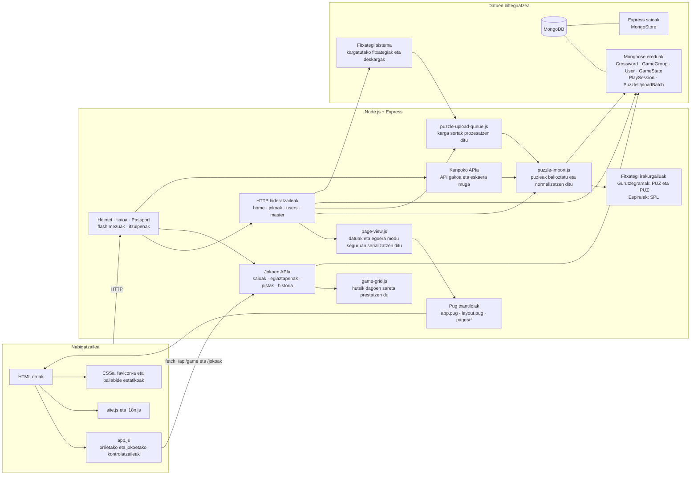

# Xederaren arkitektura

Aplikazioaren egungo egitura: Express zerbitzaria, Pug txantiloiak eta nabigatzaileko JavaScript natiboa.

## Orrien ibilbidea

- Hasierako orria (`/`) `home.pug` txantiloiarekin errendatzen da; txantiloi horrek `layout.pug` erabiltzen du oinarri.
- Gainerako orriak `page-view.js` eta `app.pug` bidez errendatzen dira. `app.pug`-ek `views/pages/` karpetako orri egokia eta goiburua eta orri-oina txertatzen ditu.
- `app.js`-ek orriaren HTMLko atributuen arabera abiarazten ditu kontrolatzaileak. `site.js`-ek nabigazio partekatua kudeatzen du; `i18n.js`-ek, berriz, itzulpenak.

## Jokoen eta puzleen ibilbidea

- `GET /jokoak/game/:id` eskaerak puzlea kargatzen du. PUZ eta IPUZ gurutzegramak `Crossword` egitura partekatuan normalizatzen dira; SPL jokoak `SpiralPuzzle` irakurgailuak kargatzen ditu. Zerbitzariak jolasteko behar diren datuak soilik bidaltzen ditu, erantzunak bezeroari erakutsi gabe.
- Joko-ekintzek `/api/game` APIra jotzen dute. Uneko jokoaren egoera Express saioan gordetzen da; erabiltzaile-kontu bati lotutako aurrerapena `GameState` eta `PlaySession` ereduetan gordetzen da.
- Puzle-kargak `jokoak` bideratzaileetatik igarotzen dira, eta `puzzle-upload-queue.js`-k eta `importPuzzle()` funtzioak prozesatzen dituzte. Emaitza `Crossword` dokumentu gisa gordetzen da; sorta eta haren egoera `PuzzleUploadBatch` ereduan erregistratzen dira.
- Ondo inportatutako jatorrizko fitxategiak `uploads/UUUU-HH-EE/` karpetan gordetzen dira, kargaren egunaren arabera (`Europe/Madrid`). Karpeta automatikoki sortzen da; jatorrizko izen segurua eta luzapena mantentzen dira, identifikatzailerik gehitu gabe. Egun berean izen bera badago, eduki bera duen fitxategia berrerabiltzen da; bestela, `_2`, `_3` eta hurrengo atzizki librera igotzen da, aurreko fitxategiak gainidatzi gabe. Balioztatu bitartean aldi baterako fitxategiak erabiltzen dira; joko baliogabeak edo errepikatuak eta huts egindako inportazioen fitxategiak ezabatu egiten dira. Sortek karpetarekiko bide erlatiboa gordetzen dute, prozesamenduak edo berrabiarazteak beste egun batean jarraituta ere fitxategia aurkitzeko.
- `/external` APIak puzleak zerrendatu, inportatu eta ezabatzeko aukera ematen du. API gako bidez babestuta dago eta eskaera kopuruaren muga du.

## Jokoen antolaketa

- `GameGroup` ereduan gordetzen dira multzoaren izena, aukerako azalpena, `parentId`, `sortOrder` eta multzo babestuen `systemKey`. Multzo bakoitzak guraso bakarra dauka; azpimultzoek beste azpimultzo batzuk izan ditzakete. `Crossword.groupIds` eremuak joko baten multzoak gordetzen ditu, jokoa bikoiztu gabe. Multzo batek zuzenean esleitutako jokoak erakusten ditu, ez bere ondorengoen joko guztiak.
- `/jokoak` erroko orria da; `/jokoak/taldeak/:id` multzo arrunten orria da. Identifikatzailearen bidezko estekek izena edo gurasoa aldatzean ere balio dute. Erroak azalpena eta berehalako azpimultzoen estekak bakarrik dauzka; ez du jokorik erakusten eta ezin zaizkio jokoak esleitu. Gainerako multzoek azalpena, azpimultzoen estekak eta joko-zerrenda partekatzen dituzte. Edukirik gabeko atalak ez dira HTMLan sortzen: ez azalpen hutsik, ez esteken edukiontzi hutsik, ez joko-zerrenda hutsik.
- `/jokoak/guztiak` orriak datu-baseko joko guztiak kontsultatzen ditu, baita multzorik gabekoak ere. `Joko guztien zerrenda` erroaren azken esteka da beti, eta ez du eskuzko joko-esleipenik. Azpimultzo-estekak zutabe bakarrean erakusten dira, goitik behera. `Jokoak` eta `Joko guztien zerrenda` ezin dira ezabatu, izenez aldatu edo mugitu; azalpenak editagarriak dira.
- `/master/groups` pantailak egitura eta joko-esleipenak kudeatzen ditu. `master` baimena eskatzen du irakurketan eta aldaketa guztietan. Multzoak sortu, editatu, ordenatu eta beste guraso batera mugi daitezke. Zuhaitzeko multzo bakoitzak editatzeko eta bere barruan azpimultzoa sortzeko botoiak dauzka; `Joko guztien zerrenda` multzoan azpimultzoak sortzeko botoia desgaituta dago. Zikloak eta ondorengo baten barrurako mugimenduak baztertzen dira. Multzoak ezabatzeko ez dute azpimultzorik, zuzenean esleitutako jokorik edo zain dauden kargarik izan behar.
- Antolaketa-pantailan multzoen zuhaitza joko-zerrendaren ondoan dago, mahaigainean ikusgai mantenduta. Joko bat edo hautatutako hainbat joko multzo batera arrasta daitezke: `Mugitu` aukerak uneko multzoko pertenentzia kentzen du; `Gehitu beste multzo batera` aukerak dauden multzo guztiak mantentzen ditu. `Joko guztien zerrenda` edo multzorik gabeko jokoen ikuspegitik gehitu egiten da beti. Ctrl, Cmd edo Alt sakatuta gehitu ere egin daiteke. Jokoak erroa eta `Joko guztien zerrenda` ez dira eskuzko esleipenen helburuak; arrastatzeak ere ezin ditu helburu gisa erabili. Zerbitzariak gordetako multzoak itzultzen ditu; zerrenda eta kontagailuak orria berriz kargatu gabe eguneratzen dira. Botoien bidezko alternatiba eskuragarri dago teklatuarekin eta ukipen-pantailetan erabiltzeko.
- Jokoak multzo batera gehitu, multzo batetik kendu edo bi multzoren artean mugi daitezke, banaka edo multzoka. Mugimenduak gainerako multzoak gordetzen ditu eta joko bakoitzaren aldaketa atomikoa da. Jokoaren identifikatzailea, partida-egoera eta estatistikak mantentzen dira. Egituraren aldaketak eta esleipenak prozesu bereko idazketa-ilaran koordinatzen dira.
- Multzo jakin baten joko-zerrendan, joko bakoitzak `Multzotik kendu` botoia dauka; hautatutako hainbat joko kentzeko botoia ere badago. Uneko multzoko pertenentzia bakarrik kentzen da, orria berriro kargatu gabe. Gainerako multzoak eta jokoa bera mantentzen dira. `Jokoak` erroan eta multzorik gabeko jokoen ikuspegian ez dira kentzeko botoiak erakusten. `Joko guztien zerrenda` ikuspegiko `Jokoa ezabatu` ekintzak, berrespena eskatu ondoren, jokoa behin betiko ezabatzen du katalogotik eta multzo guztietatik. Banaka edo multzoka egin daiteke, eta kontagailuak orria berriro kargatu gabe eguneratzen dira. `puzzle-deletion.js` zerbitzu partekatuak jokoaren partida-egoera eta estatistikak ere garbitzen ditu; webeko eta kanpoko APIko ezabaketek zerbitzu bera erabiltzen dute.
- Kargatzeko pantailak hainbat azpimultzo hautatzeko aukera ematen du; Jokoak erroa eta `Joko guztien zerrenda` ez daude helburuen artean, eta zerbitzariak ere baztertzen ditu. `PuzzleUploadBatch.groupIds` eremuan gordetzen dira; ilarak berrabiarazi ondoren ere erabiltzen ditu. Multzorik aukeratu ezean, joko berriak `Joko guztien zerrenda` orrian agertzen dira. Kanpoko API bidezko joko berriak ere ikusgai daude bertan.
- `ensureGameGroups()` abioan exekutatzen da: bi multzo babestuak sortzen ditu, izen zaharra duen multzo babestua `Joko guztien zerrenda` izenez eguneratzen du, `groupIds` eremurik ez duten joko zaharrei zerrenda hutsa ezartzen die eta Jokoak/`Joko guztien zerrenda` pertenentzia zaharrak kentzen ditu jokoetatik eta karga-sortetatik. Jokoak eta azpimultzo arrunten esleipenak mantentzen dira; multzorik gabe geratutako jokoak `Joko guztien zerrenda` orrian agertzen dira beti. Migrazioa idempotentea da. Eskuz ere exekuta daiteke `npm run groups:migrate` erabiliz, aplikazioaren `DB_CONNECTION` berarekin.

`npm test` komandoak hutsik dauden atalen errendatzea eta multzo-zuhaitza egiaztatzen ditu, eta `mongod` erabilgarri badago datu-base isolatu batean probatzen ditu migrazioa, baimenak, mugimenduak, kargak eta berriz konektatzean datuen iraunkortasuna. `MONGOD_BINARY` aldagaiak beste exekutagarri bat hauta dezake. Nabigatzaileko probak aukerakoak dira: `GROUPS_BROWSER_TEST=1 node --test tests/groups.test.js` komandoak Chrome erabiltzen du (edo `CHROME_BINARY`), sorkuntza, edizioa, arrastatzea, multzoetatik kentzea eta joko guztien zerrendako behin betiko ezabaketak egiaztatzeko, baita erroaren babesa eta mugikorreko ikuspegia ere.

## Mantentze-modua

`./update-and-restart-deploy.sh --maintenance` komandoak produkzioko aplikazio bera abiarazten du mantentze-moduan, MongoDB eta saioak mantenduta. Publikoari mantentze-orria eta `503` egoera-kodea erakusten zaizkio; `/health` eta `/ready` monitorizaziorako erabilgarri daude. Saioa hasteko orria erabil daiteke, baina `master` baimena duen erabiltzaile batek bakarrik sar daiteke `/master/groups` atalera; gainerako orriak, erregistroa eta APIak mantentze-orrian geratzen dira. Masterrak erabiltzaile-izen eta pasahitz arruntekin hasten du saioa. `./update-and-restart-deploy.sh --production` komandoak sarbide publikoa berriro irekitzen du.

Tokiko garapenak eta produkzioak Dockerfile, aplikazio-kodea eta `NODE_ENV=production` bera erabiltzen dituzte. Tokiko abiarazleak `docker-compose.production.yml` oinarria eta `docker-compose.local.yml` konfigurazio-geruza erabiltzen ditu; azken horrek soilik tokiko MongoDB helbidea, HTTPko cookieak eta segurtasun-goiburuak ezartzen ditu. Exekutatu `./scripts/start-local.sh` edo `npm run dev` ohiko moduan, eta `./scripts/start-local.sh --maintenance` mantentze-fluxua probatzeko. Lehenespenez `http://localhost:3000` erabiltzen da. `.env.local` fitxategia automatikoki sortzen da `.env.example` eredutik; tokiko Compose proiektuak bere MongoDB bolumena dauka. Lehenespenez `master` / `1234` erabiltzailea sortu edo eguneratzen da; pasahitza `LOCAL_MASTER_PASSWORD` ingurune-aldagaiarekin alda daiteke. `./scripts/start-local.sh --production` komandoak aplikazioa ohiko modura berrabiarazten du.
